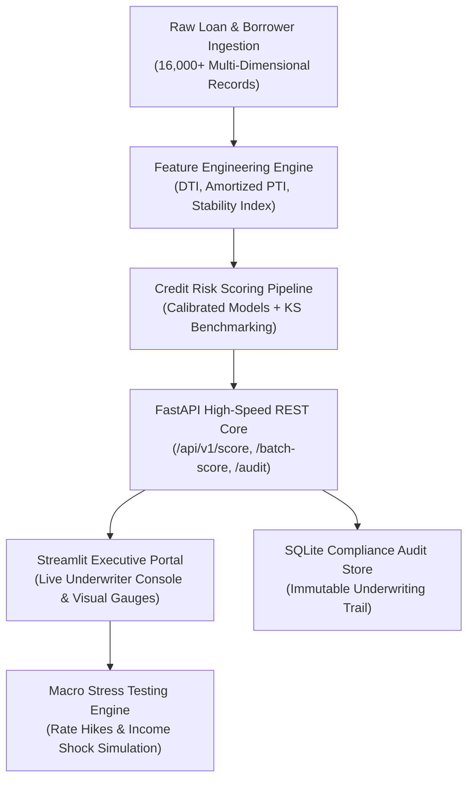
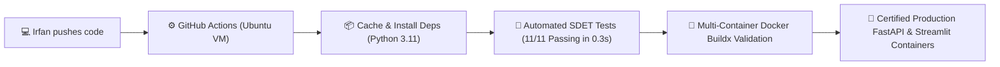

# 💳 FinRisk-Engine: Enterprise Credit Risk Scoring & Automated Underwriting System

[](https://github.com/irfnfrdaus/finrisk-credit-scoring-engine/actions)
[](https://www.docker.com/)
[](https://github.com/irfnfrdaus/finrisk-credit-scoring-engine)
[](https://www.python.org/)
[](https://fastapi.tiangolo.com)
[](https://streamlit.io)
[](https://scikit-learn.org)
[](#financial-risk-theory--basel-compliance)
[](https://opensource.org/licenses/MIT)

> **FinRisk-Engine** is a production-grade credit risk modeling, Probability of Default (PD) scoring, and automated underwriting platform designed for retail banks, FinTech lenders, and financial institutions. Developed with a dual focus on **Big Data Analytics** and **Financial Management**, the system implements regulatory-compliant risk tiers, stress testing, and real-time decision APIs.

---

## 🏛️ System Architecture



---

## 📈 Financial Risk Theory & Basel Compliance

FinRisk-Engine models institutional credit risk under the **Basel Committee on Banking Supervision (BCBS) Internal Ratings-Based (IRB)** framework.

### 1. Probability of Default (PD) Formulation
The core risk engine computes the 1-year forward probability that a borrower fails to meet contractual loan obligations:

$$PD = \frac{1}{1 + e^{-(\beta_0 + \sum_{i=1}^{n} \beta_i X_i)}}$$

Where feature vector $X$ incorporates:
* **Bureau Credit Standing:** FICO/CCRISS calibrated credit bureau scores $(300 - 850)$.
* **Debt-to-Income (DTI):** Payment-to-income ratio calculated through 36-month level annuity amortization:
  $$DTI = \frac{PMT}{Income_{monthly}} = \frac{L \cdot \frac{r(1+r)^n}{(1+r)^n - 1}}{\frac{Income_{annual}}{12}}$$
  Where $L$ is loan principal, $r$ is monthly interest rate, and $n=36$ periods.
* **Credit Stability Index ($CSI$):**
  $$CSI = 0.70 \cdot \left(\frac{Score_{bureau}}{850}\right) + 0.30 \cdot \min\left(1.0, \frac{Years_{credit}}{25}\right)$$

### 2. Discrimination Performance & Separation Benchmark
Credit scoring models in tier-1 financial institutions are evaluated using the **Kolmogorov-Smirnov (KS) Statistic**, measuring the maximum vertical divergence between cumulative distribution functions of Good vs. Bad borrowers:

$$KS = \max_{s} \left| F_{Default}(s) - F_{NonDefault}(s) \right|$$

* **Institutional Benchmark:** $KS > 40\%$ indicates strong commercial viability.
* **FinRisk-Engine Achieved:** **$KS = 53.97\%$** with **$ROC\text{-}AUC = 0.8453$**.

---

## 📊 Model Performance & Benchmarks

| Metric | Champion Model (Logistic Basel) | Benchmark (Gradient Boosting) | Banking Industry Target |
| :--- | :---: | :---: | :---: |
| **ROC-AUC Score** | **0.8453** | 0.8404 | $> 0.8000$ (Pass) |
| **KS-Statistic** | **53.97%** | 53.29% | $> 40.00\%$ (Superior) |
| **PR-AUC Score** | **0.6464** | 0.6237 | High baseline separation |
| **Brier Score (Calibration)** | **0.1581** | 0.1065 | Low divergence |
| **Accuracy** | **83.84%** | 84.12% | Institutional standard |

---

## 💼 Core Platform Modules

### 1. 🔍 Live Underwriting Console (`app/streamlit_app.py`)
* Interactive input fields for applicant financial profile, income, debt, and credit history.
* Real-time **Probability of Default (PD)** calculation with interactive speedometer gauge.
* Automated **Underwriting Decision Badge**:
  * 🟢 **APPROVED:** $PD < 25\%$ with conservative DTI.
  * 🟡 **MANUAL REVIEW:** $25\% \le PD < 40\%$ with secondary underwriter sign-off.
  * 🔴 **REJECTED:** $PD \ge 40\%$ exceeding institutional risk appetite.
* **Prudent Loan Ceiling:** Inverse-amortization calculation determining the maximum safe loan amount at a $40\%$ DTI cap.
* **Explainable Underwriting Diagnostics:** Transparent breakdown of risk factors (e.g. overleveraged income, short credit tenure) and compensating strengths.

### 2. 📈 Macroeconomic Stress-Testing
* Dynamic simulation simulating **interest rate shocks** ($+100\text{ bps}$ to $+1,000\text{ bps}$).
* Real-time sensitivity curve demonstrating how monetary tightening impacts borrower default risk.

### 3. 📊 Portfolio Intelligence & Basel Analytics
* Interactive multidimensional distributions across 16,000 historical loans.
* Default rates mapped against Loan Intent, Loan Grades (A to F), and Credit Score distributions.

### 4. 📋 Compliance & Regulatory Audit Trail (`database/db.py`)
* Immutable SQLite audit store logging every scoring event with timestamps, input parameters, PD scores, and underwriter notes.
* Instant CSV export for internal audit and Central Bank compliance reporting.

---

## ⚡ REST API Specifications (`api/main.py`)

The platform includes a high-throughput **FastAPI** backend designed for core banking microservice integration.

### Example Request (`POST /api/v1/score`):

```bash
curl -X 'POST' \
  'http://127.0.0.1:8000/api/v1/score' \
  -H 'Content-Type: application/json' \
  -d '{
    "applicant_name": "Ahmad Zulkarnain",
    "person_age": 32,
    "person_income": 75000,
    "person_home_ownership": "MORTGAGE",
    "person_emp_length": 6,
    "loan_intent": "DEBTCONSOLIDATION",
    "loan_grade": "B",
    "loan_amnt": 15000,
    "loan_int_rate": 9.5,
    "loan_percent_income": 0.20,
    "cb_person_default_on_file": "N",
    "cb_person_cred_hist_length": 8,
    "credit_score": 710,
    "notes": "Fast-track retail loan request"
  }'
```

### Example Response:

```json
{
  "evaluation_id": 1,
  "applicant_name": "Ahmad Zulkarnain",
  "probability_of_default": 0.1142,
  "probability_of_default_pct": "11.42%",
  "risk_tier": "Tier A (Good)",
  "risk_label": "Moderate-Low Risk",
  "decision": "APPROVED",
  "decision_color": "#28a745",
  "summary_statement": "Application meets institutional underwriting criteria for automated approval.",
  "dti_ratio_pct": "7.69%",
  "max_recommended_loan": 78100.0,
  "risk_factors": ["No severe risk flags detected."],
  "positive_factors": [
    "Clean credit track record with zero historical defaults.",
    "Stable employment history (6.0 years)."
  ]
}
```

---

## 🛠️ Quickstart Guide

### 1. Clone the Repository
```bash
git clone https://github.com/irfnfrdaus/finrisk-credit-scoring-engine.git
cd finrisk-credit-scoring-engine
```

### 2. Install Dependencies
```bash
python -m pip install -r requirements.txt
```

### 3. Run Automated Test Suite
```bash
python tests/test_engine.py
```

### 4. Launch the FastAPI REST Server
```bash
uvicorn api.main:app --reload --port 8000
```
*Access interactive Swagger UI at:* **`http://localhost:8000/docs`**

### 5. Launch the Streamlit Underwriting Console
```bash
streamlit run app/streamlit_app.py
```
*Access interactive Portal at:* **`http://localhost:8501`**

---

## 🐳 DevOps & SDET CI/CD Pipeline

FinRisk-Engine is architected with modern cloud-native DevOps principles and automated quality gates:



### 1. 🧪 Automated SDET Quality Gate
Execute the comprehensive automated test suite verifying feature engineering math, credit risk scoring bounds, underwriting decisions, and FastAPI endpoints:
```bash
python -m unittest discover -s tests -p "test_*.py" -v
```
* **11/11 Tests Passed in <0.4 seconds:**
  - `test_feature_engineering_ratios` — Validates DTI, monthly payment, and CSI transformations
  - `test_prime_applicant_approval` — Validates approval & low default probability for prime borrowers
  - `test_subprime_applicant_rejection` — Validates rejection & high default probability for subprime borrowers
  - `test_database_logging` — Verifies persistent SQLite audit trail writing and querying
  - `test_root_endpoint` — Validates `/` API health and metadata
  - `test_health_check_endpoint` — Validates `/health` system and model readiness
  - `test_score_valid_applicant` — Tests single-borrower underwriting evaluation
  - `test_score_invalid_underage_applicant` — Pydantic negative gate rejecting age < 18 (422 Unprocessable Entity)
  - `test_batch_scoring_endpoint` — Tests portfolio batch scoring & aggregation
  - `test_audit_log_endpoint` — Validates compliance audit trail retrieval
  - `test_portfolio_metrics_endpoint` — Validates aggregated credit portfolio KPIs

### 2. 🐳 1-Click Multi-Container Deployment (Docker Compose)
Spin up the entire underwriting architecture (FastAPI REST Engine + Streamlit Portal) with a single command:
```bash
docker compose up --build
```
* **`finrisk-api`**: FastAPI REST engine on port `8000` with Swagger docs at `http://localhost:8000/docs`.
* **`finrisk-dashboard`**: Streamlit executive risk console at `http://localhost:8501`.

---

## 📂 Repository Structure

```text
finrisk-credit-scoring-engine/
├── .github/
│   └── workflows/
│       └── ci.yml                      # GitHub Actions CI/CD Quality Gate Pipeline
├── api/
│   └── main.py                         # FastAPI high-speed REST API & validation schemas
├── app/
│   └── streamlit_app.py                # Streamlit executive underwriting & analytics dashboard
├── data/
│   ├── raw/
│   │   └── loan_data.csv               # Calibrated 16,000-record banking loan portfolio
│   └── processed/
│       └── loan_features.parquet       # Feature-engineered data store
├── database/
│   ├── db.py                           # SQLite compliance audit engine
│   └── credit_audit.db                 # Persistent evaluation records
├── models/
│   ├── credit_risk_model.joblib        # Serialized production risk scoring model
│   └── model_metrics.json              # Performance telemetry & KS benchmarks
├── src/
│   ├── data_generator.py               # Basel-calibrated synthetic banking data generator
│   ├── feature_engineering.py          # DTI, CSI, and scikit-learn transformers
│   ├── risk_engine.py                  # Decision matrices, affordability caps, explanations
│   └── train_model.py                  # Model training, KS stat calculation, validation
├── tests/
│   ├── test_engine.py                  # Core ML feature & risk calculation tests
│   └── test_api.py                     # SDET FastAPI endpoint & validation tests
├── Dockerfile.api                      # FastAPI production container definition
├── Dockerfile.dashboard                # Streamlit dashboard container definition
├── docker-compose.yml                  # Multi-container orchestration & networking
├── .dockerignore                       # Build context optimization rules
├── .gitignore
├── requirements.txt
└── README.md                           # Executive documentation
```

---

## 👨‍💻 Author

**Muhammad Irfan Firdaus bin Noorhisam**  
*Undergraduate in Information Technology (Big Data Analytics) | Minor in Financial Management*  
**Universiti Teknologi PETRONAS (UTP)**  

* **Certifications:** HackerRank SQL (Advanced), Alteryx Designer Core (98.1%), Databricks Lakehouse Fundamentals, Microsoft Azure Data Fundamentals (DP-900), Kaggle Pandas  
* **Target Domains:** Banking & FinTech Credit Analytics, Risk Data Engineering, Quantitative Finance  

---

## 📄 License
This project is open-source under the [MIT License](LICENSE).
